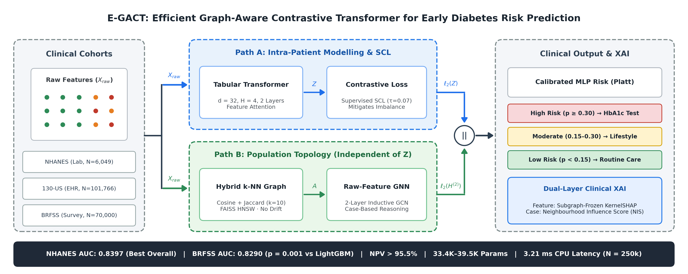

# Resource-Efficient Graph-Aware Contrastive Transformer (E-GACT)

<p align="center">
  
</p>

[](https://opensource.org/licenses/MIT)
[](https://www.python.org/downloads/)
[](https://pytorch.org/)
[](#)

> **Official Code Repository for the paper:**  
> *"Resource-Efficient Graph-Aware Contrastive Transformer (E-GACT) for Early Diabetes Risk Prediction: Bridging Algorithmic Topology and Clinical Explainability"*  
> Submitted to **Computer Methods and Programs in Biomedicine** (Elsevier, Q1, WoS SCIE)

---
## 🖼️ Graphical Abstract
<p align="center">  </p>

Left to right: Input cohorts (NHANES, 130-US, BRFSS) → Path A (Tabular Transformer + SCL) → Path B (Hybrid Cosine–Jaccard GNN on raw features) → Classifier (MLP + Platt calibration) → Clinical outputs (risk strata, KernelSHAP, NIS).

## ⚡ Reproducibility

**Instructions:**

1. Open our official interactive Notebook via Google Colab:  
   [](https://colab.research.google.com/github/medical-ai-researcher/E-GACT/blob/main/E_GACT_FINAL.ipynb)

2. *(Optional)* Set Hardware Accelerator to **T4 GPU** (`Runtime → Change runtime type`); checkpoint verification and single-thread inference profiling also run directly on CPU.

3. Click **`Runtime → Run All`**.

Pre-computed checkpoints are loaded automatically — full verification runs in **~5 minutes** without retraining.

> **📝 Note:** Manuscript experiments were executed with 5-fold stratified CV (`seed=42`). Pre-computed E-GACT (`*_cv.json`) and ablation (`*_ablation.json`) checkpoints reproduce all E-GACT CV metrics (Tables 3–4), ablation results (Table 5, Fig. 3a), and calibration/XAI figures; auxiliary `*_sota.json` checkpoints store 5-fold comparator AUC slices (full 4-metric baseline logs are reported in Table 3).

---

## 📖 Overview

E-GACT addresses three clinical bottlenecks via a **dual-path architecture**:

1. **Path A — Tabular Transformer:** Lightweight intra-patient feature modelling (`d=32`, `H=4`, 2 layers).
2. **Path B — Raw-Feature GNN:** Strictly inductive *k*-NN graph (`k=10`) built on raw feature space via a novel **hybrid cosine–Jaccard similarity metric** (`α=0.5`) — independent of Path A, built once per fold via FAISS FlatIP/HNSW.
3. **Supervised Contrastive Learning (SCL):** Regularises against class imbalance (`τ=0.07`, `λ=0.6`).
4. **Dual-Layer Clinical Explainability:** Subgraph-frozen KernelSHAP + Neighbourhood Influence Score (NIS) + Case Retrieval.

**Key numbers:**

| Metric | Value |
|:---|:---|
| Parameters (NHANES) | 39,473 |
| Parameters (BRFSS) | 33,425 |
| Parameters (130-US) | ~150,000 |
| CPU Inference (N=250k) | 3.21 ms / patient (FP32) |
| INT8 Inference (N=250k) | 3.81 ms / patient |
| Model weights (FP32 / INT8) | 145.1 KB / 90.9 KB |
| Complexity | O(N log N) |

---

## 📊 Results Summary

Evaluated via **5-fold stratified CV** against **8 baselines** across 3 primary clinical cohorts and 1 balanced control cohort (empirical scalability profiled over `N ∈ [5k, 250k]` from the full 253,680-patient BRFSS 2015 release).

| Dataset | E-GACT AUC | Best Baseline | Status |
|:---|:---|:---|:---|
| **NHANES** (N=6,049) | **0.8397 ± 0.005** | CatBoost 0.8364 | ✅ Best across all metrics |
| **130-US** (N=101,766) | 0.6585 ± 0.007 | LightGBM 0.6777 | ✅ Best among deep learning |
| **BRFSS imbalanced** (N=70,000) | **0.8290 ± 0.004** | MLP 0.8296 | ✅ p=0.001 vs LightGBM |
| **BRFSS balanced** (N=50,000) | **0.8304 ± 0.003** | SAINT 0.8305 | ✅ Balanced control benchmark |

---

## 📊 Datasets

| Dataset | Modality | N | F | Target | Pos. (%) |
|:---|:---|:---|:---|:---|:---|
| [NHANES (2017–2018)](https://wwwn.cdc.gov/nchs/nhanes/continuousnhanes/default.aspx?BeginYear=2017) | Clinical Lab | 6,049 | 84 | Early T2DM (HbA1c ≥6.5% or FPG ≥126 mg/dL) | 14.3 |
| [130-US Hospitals](https://archive.ics.uci.edu/dataset/296/) | EHR | 101,766 | 45 | 30-Day Readmission | 11.2 |
| [CDC BRFSS (2015)](https://www.cdc.gov/brfss/) | Population Survey | 70,000 / 50,000 | 21 | T2DM (self-reported) | 13.9 / 50.2 |

---

## 🔍 Dual-Layer XAI

**Layer 1 — Subgraph-Frozen KernelSHAP**  
Top NHANES predictors: Age, family history (MCQ300C), statin use, waist circumference.  
Top BRFSS predictors: GenHlth, BMI, Age, HighBP, HighChol.

**Layer 2 — Neighbourhood Influence Score + Case Retrieval**  
`NIS(i) = ŷᵢ − mean(ŷ_neighbours)`. Case vignette (#12440): `Δtopo=+0.055` elevates a borderline patient (`0.272 → 0.327`) into High-Risk, triggering timely HbA1c testing.

---

## 📝 Citation

```bibtex
@article{atas2026egact,
  title   = {Resource-Efficient Graph-Aware Contrastive Transformer (E-GACT)
             for Early Diabetes Risk Prediction: Bridging Algorithmic
             Topology and Clinical Explainability},
  author  = {Ata\c{s}, {\.I}sa},
  journal = {Computer Methods and Programs in Biomedicine},
  year    = {2026},
  note    = {Under review}
}
```

---

## 📄 License

MIT License — see [LICENSE](LICENSE) for details.
