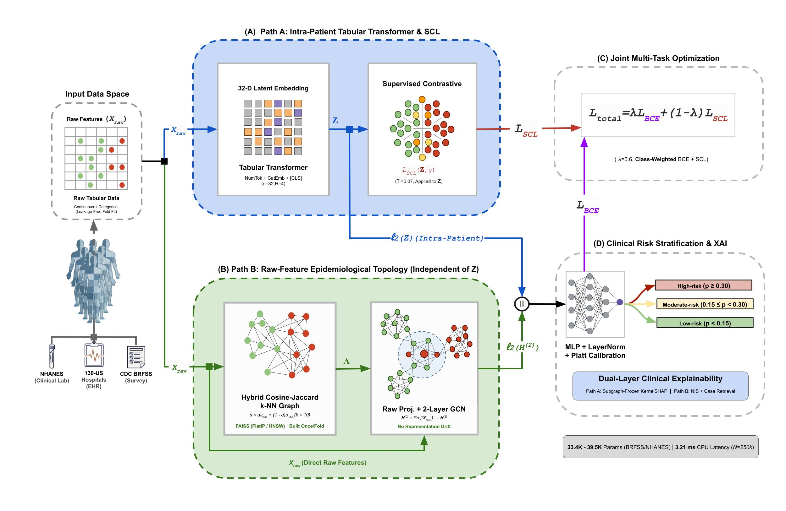

# Resource-Efficient Graph-Aware Contrastive Transformer (E-GACT)

[](https://opensource.org/licenses/MIT)
[](https://www.python.org/downloads/)
[](https://pytorch.org/)
[-green.svg)](#)

> **Official Code Repository for the paper:**  
> *"Resource-Efficient Graph-Aware Contrastive Transformer (E-GACT) for Early Diabetes Risk Prediction: Bridging Algorithmic Topology and Clinical Explainability"*  
> Submitted to **Artificial Intelligence in Medicine** (Elsevier, IF=7.8, Q1).

---
<p align="center">  </p>

## ⚡ Zero-Click Reproducibility (Reviewer Guide)

We deeply respect the time of academic peer-reviewers. To facilitate a seamless and transparent review process, we provide an automated, **"Zero-Click" Universal Data Pipeline**.
- No Google Drive mounting required.
- No API keys, credentials, or manual dataset downloads needed.

**Instructions:**
1. Open our official interactive Notebook via Google Colab:  
   [](https://colab.research.google.com/drive/1AroQ5a6Il4cyYqf21RW21rxwGuhp4wYB)
2. Ensure the Hardware Accelerator is set to **T4 GPU** (`Runtime → Change runtime type`).
3. Click **`Runtime → Run All`**.
4. The script will autonomously fetch the raw clinical cohorts, perform strictly inductive leakage-free graph construction, train the E-GACT architecture, compute Neighbourhood Influence Scores (NIS), and output the ROC-AUC benchmarks alongside high-resolution XAI figures.

> **📝 Editorial Note on Colab Constraints:** Results reported in the main manuscript (Tables 3–4) are derived from rigorous 5-fold stratified cross-validation on a dedicated cluster (RTX 4090). To satisfy Colab's free-tier constraints (15 GB RAM), this reproducibility notebook uses a single 80/20 stratified split and reduces the FAISS HNSW parameter to M=16 (instead of M=32). Results closely approximate, but may marginally differ from, the tabled 5-fold figures.

> **🔒 Data Provenance Note (NHANES):** The NHANES dataset hosted here is a direct, unmodified ZIP archive of the original CDC XPT files, mirrored to bypass frequent CDC server timeouts and enable zero-click Colab execution. The original CDC fetch script is available in `download_from_cdc.py`.

---

## 📖 Overview

Predicting Type 2 Diabetes Mellitus (T2DM) and associated clinical outcomes from tabular Electronic Health Records (EHR) is critical for early intervention. Current deep tabular models underperform against tree-based ensembles on noisy clinical datasets and fail to scale on large cohorts due to O(N²) attention complexity. Standard algorithms also evaluate patients as i.i.d. instances, ignoring the fundamental clinical paradigm of **Case-Based Reasoning**.

**E-GACT** addresses these bottlenecks via a **dual-path architecture**:

1. **Path A — Tabular Transformer:** Lightweight intra-patient feature modelling (d=32, H=4, 2 layers).
2. **Path B — Raw-Feature GNN:** Strictly inductive k-NN graph built on raw feature space via a novel **hybrid cosine–Jaccard similarity metric** — independent of Path A, eliminating representation drift by design (built once per fold, FAISS FlatIP/HNSW).
3. **Supervised Contrastive Learning (SCL):** Regularises the transformer path against class imbalance (τ=0.07, λ=0.6).
4. **Dual-Layer Clinical Explainability:** Subgraph-frozen KernelSHAP (feature-level) + Neighbourhood Influence Score / Case Retrieval (topology-level).

**Key numbers:**
- **39,473 parameters** (NHANES, no categorical embeddings) / **33,425** (BRFSS) / **~150,000** (130-US with categorical embeddings)
- **3.21 ms** single-thread CPU inference latency at N=250,000 (FP32) / **3.81 ms** (INT8)
- **90.9 KB** model weights (INT8, BRFSS)
- **O(N log N)** inductive inference via FAISS HNSW

---

## 📊 Results Summary

Evaluated via **5-fold stratified CV** against **8 baselines** (LightGBM, XGBoost, CatBoost, MLP, TabNet, FT-Transformer, SAINT, GraphSAGE) across 3 primary clinical cohorts + 1 balanced control.

| Dataset | E-GACT AUC | Best Baseline | Δ |
|:---|:---|:---|:---|
| **NHANES** (N=6,049, 14.3% prev.) | **0.8397 ± 0.005** | CatBoost 0.8364 | +0.003 |
| **130-US** (N=101,766, 11.2% prev.) | 0.6585 ± 0.007 | LightGBM 0.6777 | −0.019 |
| **BRFSS imbalanced** (N=70,000, 13.9% prev.) | **0.8290 ± 0.004** | MLP 0.8296 | −0.001 |
| **BRFSS balanced** (N=50,000, 50% prev.) | **0.8304 ± 0.003** | SAINT 0.8305 | −0.001 |

**Key results:**
- E-GACT surpasses all 8 baselines on NHANES across **all 4 metrics** (AUC, AUPRC, F1, Brier)
- Statistically significant vs. LightGBM on BRFSS imbalanced: DeLong p=0.001 (Bonferroni-corrected)
- SAINT and GraphSAGE collapse to near-random (AUC~0.53) on 130-US; E-GACT remains robust
- CPU latency: 3.21 ms/patient at N=250k — suitable for point-of-care edge deployment

---

## 📊 Benchmarked Datasets

| Dataset | Modality | N | F | Target | Pos. (%) |
|:---|:---|:---|:---|:---|:---|
| [NHANES (2017–2018)](https://wwwn.cdc.gov/nchs/nhanes/) | Clinical Lab + Demographics | 6,049 | 84 | Early T2DM (HbA1c ≥6.5%) | 14.3 |
| [130-US Hospitals](https://archive.ics.uci.edu/dataset/296/) | EHR | 101,766 | 45 | 30-Day Readmission | 11.2 |
| [CDC BRFSS (2015)](https://www.cdc.gov/brfss/annual_data/annual_2015.html) | Population Survey | 70,000 (imb.) / 50,000 (bal.) | 21 | T2DM (self-reported) | 13.9 / 50.2 |

---

## 🔍 Dual-Layer Clinical Explainability (XAI)

E-GACT avoids the black-box paradigm via two complementary layers:

**Layer 1 — Subgraph-Frozen KernelSHAP (Feature-Level)**  
Path B graph and hidden representations are frozen, reducing the model to a deterministic local function for SHAP attribution. Top NHANES predictors: Age, family history of diabetes (MCQ300C), statin use, waist circumference. Top BRFSS predictors: GenHlth, BMI, Age, HighBP, HighChol.

**Layer 2 — Neighbourhood Influence Score + Case Retrieval (Topology-Level)**  
NIS(i) = ŷᵢ − mean(ŷ_neighbours) quantifies how much the historical neighbourhood shifts each patient's predicted risk. Case vignettes demonstrate that Path B elevates borderline cases into the high-risk stratum (e.g., Δtopo=+0.055, Moderate→High, triggering HbA1c referral).

---

## 📝 Citation

If you find this codebase or methodology useful, please cite:

```bibtex
@article{egact2026,
  title   = {Resource-Efficient Graph-Aware Contrastive Transformer (E-GACT)
             for Early Diabetes Risk Prediction: Bridging Algorithmic
             Topology and Clinical Explainability},
  author  = {Anonymous Authors},
  journal = {Artificial Intelligence in Medicine},
  year    = {under review}
}
```

---

## 📄 License

MIT License — see [LICENSE](LICENSE) for details.
